# Where Are NWS Snowfall Forecasts Biased in New England?

### A gridded verification of WFO-edited NDFD snowfall forecasts against NOHRSC snowfall analyses, November 2018 – April 2026

<p align="center">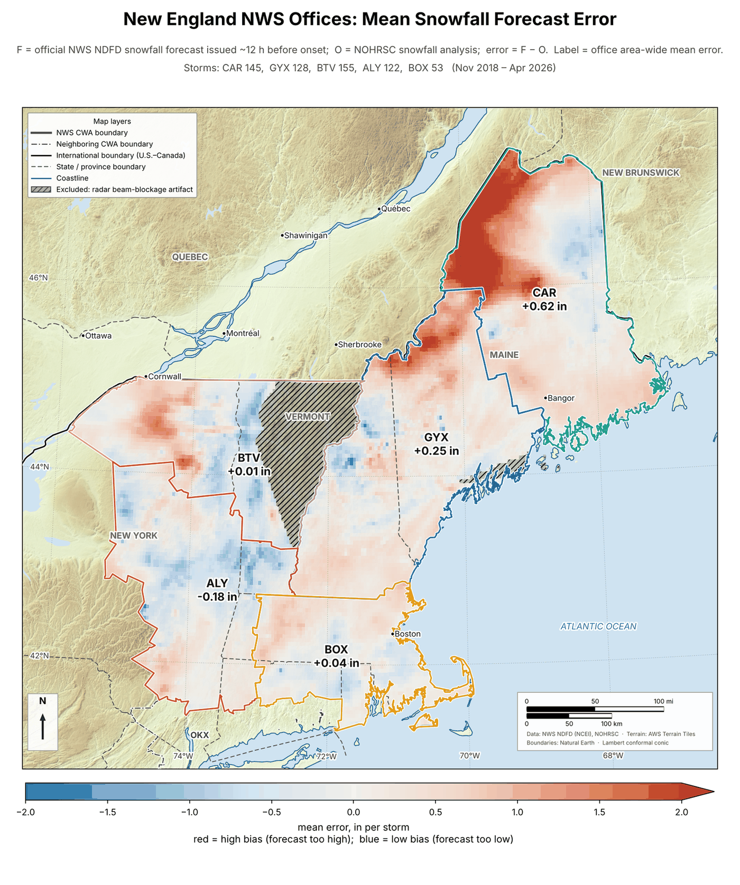</p>

*Each cell is the average of (forecast − observed) storm-total snowfall over every significant storm in the record, drawn at the native ~4 km resolution of the observation grid with no smoothing. Red = the forecast was too high on average; blue = too low.*

---

## Abstract

Official snowfall forecasts are issued by individual NWS Weather Forecast Offices (WFOs), and each office's forecasters edit the gridded forecast by hand. This study asks a simple question for the New England offices — **CAR, GYX, BTV, ALY, BOX and OKX**: *where, and by how much, are the forecasts biased?* It verifies the **official, WFO-issued NDFD snowfall forecast** (not the National Blend of Models) against the **NOHRSC National Snowfall Analysis** for **635 office-storms** between November 2018 and April 2026, and maps the error at the native 0.04° (~4 km) grid of the analysis.

Main findings:

1. **Typical error is similar everywhere; bias is not.** Mean absolute error is 1.7–1.9 in per storm and the hit rate is 70–74 % at every office, but the *sign and spatial structure* of the bias differs sharply.
2. **Caribou (CAR) is the one office with a robust area-wide high bias:** +0.62 in per storm (90 % interval +0.41 to +0.82), a 16 % percent bias, concentrated in a reproducible hot spot in northwestern Maine and on the hills. Gray/Portland (GYX) is mildly high (+0.25 in, interval +0.03 to +0.47). Burlington, Boston/Norton and New York/Upton are statistically indistinguishable from zero over the full record, and Albany is slightly low (−0.18 in, interval includes zero).
3. **Area-wide averages hide an amount-dependent pattern.** Taken as a user would see it — *given a forecast* — forecasts of 6 in or more verify lower than forecast on average (+1.1 in for 6–9 in, +2.2 in for 12 in or more). Taken the other way — *given what fell* — the largest observed amounts were under-forecast (−4.0 in at 12 in or more). These are two views of the same imperfect forecast, not two different biases (section 5.4).
4. **The biggest misses are storm-specific and often shared by neighbors.** Albany's worst storm (17 Dec 2020) verified at 23.8 in against a forecast of 10.6 in; the 23–24 March 2024 storm was over-forecast at CAR (+5.7 in) and under-forecast at GYX (−4.4 in) at the same time.
5. **In 2025–26 the northern bias persisted** (CAR +0.63 in) **while the southern offices swung low** (ALY −0.50 in, interval entirely below zero), on small samples (5–24 storms per office).

Everything in this repository — data download, storm detection, verification, statistics and all maps — is produced by one Python script and can be re-run end to end.

---

## Contents

1. [Questions](#1-questions)
2. [Study area and period](#2-study-area-and-period)
3. [Data](#3-data)
4. [Methods](#4-methods)
5. [Results](#5-results)
6. [Discussion](#6-discussion)
7. [Limitations and threats to validity](#7-limitations-and-threats-to-validity)
8. [Reproducing the study](#8-reproducing-the-study)
9. [Repository layout](#9-repository-layout)
10. [Data sources and credits](#10-data-sources-and-credits)

---

## 1. Questions

1. For each New England WFO, is the official snowfall forecast biased high or low, and by how much?
2. Is the bias uniform across an office's county warning area (CWA), or does it concentrate in particular places — mountains, the coast, the Canadian border?
3. Does the bias depend on how much snow is forecast or observed?
4. Are the spatial patterns *real* (reproducible) or sampling noise?
5. How did the most recent season (2025–26) compare with the long-term record?

A deliberate design choice: the study reports the **error as a map**, at the resolution of the observations, rather than a single number per office. A forecast office's average hides the places where its forecasts are reliable and the places where they are not.

## 2. Study area and period

The six WFOs whose warning areas cover New England and eastern New York. Their CWAs are the NWS county warning area polygons (section 10).

| Office | Storms (full record) | First storm | Last storm | 12-h / 6-h lead | CWA cells used | Cells excluded (radar) |
|---|--:|---|---|--:|--:|--:|
| CAR | 145 | 2018-11-10 | 2026-04-03 | 144 / 1 | 3,780 | 0 |
| GYX | 128 | 2018-11-09 | 2026-03-24 | 126 / 2 | 3,858 | 75 |
| BTV | 155 | 2018-11-09 | 2026-03-23 | 152 / 3 | 1,885 | 954 |
| ALY | 122 | 2018-11-09 | 2026-03-14 | 119 / 3 | 2,776 | 0 |
| BOX | 53 | 2018-11-15 | 2026-02-24 | 53 / 0 | 1,754 | 0 |
| OKX | 32 | 2018-11-15 | 2026-02-24 | 32 / 0 | 1,104 | 0 |

*Cells are 0.04° NOHRSC analysis cells (about 4.4 km north–south by 3.2 km east–west at 44°N) whose centers fall inside the CWA. Radar-excluded cells are explained in section 4.5.*

**Period.** Cold-season months only (November – April), 2018-11-01 to 2026-04-30. The NDFD archive at NCEI begins in June 2018, which sets the start. Of the 635 office-storms, 626 use a forecast issued at least 12 h before the storm and 9 use a 6-h fallback.

## 3. Data

| Role | Product | Details |
|---|---|---|
| **Forecast** | NDFD "Snowfall Accumulation" grids, NCEI THREDDS archive | WMO header `YSUZ98`, originating center `KWBN`; 6-hour accumulation messages on the 2.5 km CONUS NDFD grid; from June 2018. This is the gridded forecast each WFO publishes after forecaster editing — **not** the NBM. |
| **Observation** | NOHRSC National Snowfall Analysis (`sfav2`), 6-hour snowfall | 0.04° CONUS grid (1500 × 850 cells), inches, `sfav2_CONUS_6h_YYYYMMDDHH.tif`, named by period end time. A gridded analysis that blends a model background with station reports — an analysis, not ground truth. |
| **Terrain** | AWS Terrain Tiles (Terrarium PNG), zoom 8 | Mosaicked and resampled to a 0.004° elevation grid; used for terrain shading and for the elevation / distance-to-ocean analysis. |
| **Boundaries** | NWS County Warning Area polygons; Natural Earth 10 m | CWA outlines (bundled in `data/`, refreshable from the NWS reference map service); coastline, ocean and lakes, state/province lines, international boundary, places. |

## 4. Methods

### 4.1 Storm identification

Storms are found **from the observations**, separately for each office, so the sample does not depend on what was forecast:

1. Average the NOHRSC 6-hour snowfall over all cells in the CWA → a CWA-mean 6-hour series.
2. A period is "snowing" if the CWA mean is ≥ **0.08 in**.
3. Snowing periods less than **12 h** apart are merged into one event.
4. Keep events whose CWA-mean total is ≥ **1.5 in**.
5. Events longer than **48 h** are split at their quietest 6-hour period.

The storm window starts at the beginning of the first snowing period (period end − 6 h) and ends at the end of the last. Because of the 1.5 in floor, **the study describes significant snowstorms, not all snowfall**.

### 4.2 Forecast selection

For each storm, the forecast is the **latest NDFD run issued at least 12 h before the window opens** (falling back to 6 h, which was needed for 9 of the 635 office-storms). The 6-hour forecast messages that cover the window are summed to a storm-total forecast. Using a fixed lead keeps the comparison to "the forecast a user could have seen the evening before," and avoids letting late forecast updates absorb the error.

### 4.3 Putting both fields on one grid

NDFD is 2.5 km on a Lambert conformal grid; NOHRSC is 0.04° latitude–longitude. Each NOHRSC cell receives the **area average of 5 × 5 bilinear samples** of the NDFD grid spanning the cell, computed as one sparse-matrix multiply per message. Forecasts are converted from metres to inches. No smoothing is applied to either field; the maps show the cells as they are.

### 4.4 Metrics

With forecast *F*, observation *O* and error *E = F − O* for every cell and storm:

| Metric | Definition |
|---|---|
| **Mean error (bias)** | mean(*F − O*), in per storm. Positive = forecast too high. |
| MAE | mean(\|*F − O*\|) |
| RMSE | √mean((*F − O*)²) |
| **Percent bias** | 100 · Σ(*F − O*) / Σ*O* (masked where mean *O* < 1 in per storm) |
| Normalized MAE | 100 · Σ\|*F − O*\| / Σ*O* |
| **Hit** | \|*F − O*\| ≤ max(2 in, 30 % of *O*) |
| High / low bias | *F − O* above +tolerance / below −tolerance |
| Heavy-snow case | max(*F*, *O*) ≥ 4 in; per-cell rates need ≥ 8 such cases |
| Reliability category (cell) | *Reliable*: hit rate ≥ 60 %. Otherwise *high bias* or *low bias* if the high-minus-low rate gap is ≥ 20 points, else *mixed* |

Maps of mean error blank any cell with valid data in fewer than 90 % of storms. Statistics in the tables pool every (cell, storm) case, so they weight each cell equally.

### 4.5 Radar beam-blockage artifacts

The NOHRSC analysis leans on radar-based estimates, and terrain blocks the radar beam in places, leaving straight radial streaks that follow the geometry of the radar rather than the weather. They were found with an **azimuthal-anomaly test** (`radar-test` command): around a radar site, compare ln(*O*/*F*) in each 1° azimuth bin with neighboring azimuths at the same range; a narrow azimuth band that is low (or high) for many consecutive range gates is geometry, not weather. Two sectors were confirmed and are **hatched on the maps and excluded from every statistic**:

| Office | Radar | Excluded sector | Cells excluded |
|---|---|---|---|
| BTV | KCXX (Burlington) | azimuth 30°–160°, range > 15 km | 954 of 2,839 (34 %) |
| GYX | KGYX (Gray) | azimuth 69°–82°, range > 15 km | 75 of 3,933 (1.9 %) |

The BTV exclusion is large: **Burlington's statistics describe its western and northern CWA, not the eastern Vermont sector.**

### 4.6 Terrain and reproducibility analysis

* **Terrain classes** use the terrain tiles: coast (< 15 km from the ocean), inland lowland (< 200 m), hills (200–600 m), mountains (≥ 600 m).
* **Terrain-explained variance.** Percent bias per cell is regressed on elevation and log distance to the ocean with a Gaussian kernel regression; the squared correlation with the actual map is the share of the spatial pattern that terrain and coast distance alone reproduce.
* **Split-half reproducibility.** The storms are split at random into two halves 100 times, percent bias is computed per cell in each half, and the correlation between halves is taken (median reported). A high value means the spatial pattern is a stable property of the forecasts; a low value means it is sampling noise.

### 4.7 Uncertainty

Intervals on area-wide mean error are **90 % storm-bootstrap intervals** (5,000 resamples of each office's storms, using each storm's area-mean error). They assume storms are exchangeable; they do not account for correlation between neighboring offices, which see the same storms.

### 4.8 Cartographic design

All maps share one set of conventions so they can be compared directly. Lambert conformal conic projection (central meridian 71.5°W, standard parallels 42°N and 46°N). Layers, bottom to top: terrain shading, water, the data (native cells masked to the CWA), then boundaries above the data so they stay visible inside the CWA — the international boundary (solid black, white casing), state and province lines (dashed gray), the coastline (thin blue; islets under ~5 km² generalized away), the focus CWA (office color, white halo) and neighboring CWAs (dash-dot, labelled). Each map has a labelled graticule, state and water-body names placed outside the data, reference cities, a legend limited to the symbols present, a dual mile/kilometre scale bar, a north arrow rotated for local grid convergence, and a data credit. Every office uses the same fixed diverging color scale (±2 in for mean error), colorbars get arrow ends where values are clipped, and radar-excluded cells are hatched and listed in the legend.

## 5. Results

### 5.1 Area-wide verification, full record

| Office | Storms | Mean F (in) | Mean O (in) | **Mean error (in)** [90% interval] | MAE (in) | RMSE (in) | Percent bias | Norm. MAE | Hit rate | High / low bias |
|---|--:|--:|--:|--:|--:|--:|--:|--:|--:|--:|
| **CAR** Caribou, ME | 145 | 4.40 | 3.78 | **+0.62** [+0.41, +0.82] | 1.81 | 2.63 | +16.4% | 48% | 70% | 21% / 9% |
| **GYX** Gray/Portland, ME | 128 | 4.25 | 4.00 | **+0.25** [+0.03, +0.47] | 1.70 | 2.55 | +6.2% | 43% | 72% | 17% / 10% |
| **BTV** Burlington, VT | 155 | 3.60 | 3.59 | **+0.01** [−0.20, +0.22] | 1.69 | 2.52 | +0.3% | 47% | 73% | 15% / 13% |
| **ALY** Albany, NY | 122 | 3.67 | 3.85 | **−0.18** [−0.49, +0.11] | 1.75 | 3.13 | −4.7% | 46% | 74% | 14% / 13% |
| **BOX** Boston/Norton, MA | 53 | 4.51 | 4.47 | **+0.04** [−0.44, +0.51] | 1.89 | 2.85 | +0.9% | 42% | 71% | 16% / 13% |
| **OKX** New York/Upton, NY | 32 | 4.70 | 4.68 | **+0.01** [−0.53, +0.49] | 1.75 | 2.42 | +0.2% | 37% | 71% | 16% / 13% |

*Mean F / O: average storm-total forecast and observation per cell and storm. Hit = within max(2 in, 30 % of O). Interval = 90 % storm-bootstrap interval on mean error (section 4.7). All numbers are in `results/office_summary.csv`.*

* **Error magnitude is nearly the same everywhere.** MAE spans only 1.69–1.89 in, and hit rates 70–74 %. OKX and BOX have the lowest normalized MAE (37 % and 42 %), partly because their storms are larger on average (mean observed 4.5–4.7 in versus 3.6–4.0 in elsewhere).
* **Bias separates the offices.** Only CAR (+0.62 in) and, marginally, GYX (+0.25 in) have 90 % intervals that exclude zero on the high side. BTV, BOX and OKX are within ±0.05 in of zero; ALY is −0.18 in with an interval that spans zero.
* **Near-zero area means can hide offsetting errors.** BTV's mean error is +0.01 in, yet 23 % of its (non-excluded) area has a mean error above +0.5 in and 21 % below −0.5 in:

| Office | Storm-mean F vs O correlation | Storms within tolerance band | Storms with area-mean error > +0.5 in | Storms < −0.5 in | CWA area with mean error > +0.5 in | CWA area < −0.5 in |
|---|--:|--:|--:|--:|--:|--:|
| CAR | 0.88 | 59% | 74 of 145 | 29 of 145 | 45% | 5% |
| GYX | 0.85 | 68% | 49 of 128 | 30 of 128 | 21% | 6% |
| BTV | 0.84 | 69% | 50 of 155 | 49 of 155 | 23% | 21% |
| ALY | 0.83 | 60% | 36 of 122 | 50 of 122 | 4% | 24% |
| BOX | 0.84 | 55% | 22 of 53 | 17 of 53 | 11% | 7% |
| OKX | 0.89 | 47% | 14 of 32 | 10 of 32 | 10% | 11% |


* **Heavy snow is much harder than snow overall.** Restricting to cases where either F or O reaches 4 in, the hit rate falls from ~72 % to 47–54 %, and misses split between high and low:

| Office | Heavy-snow cell-storm cases | Hit | High bias | Low bias |
|---|--:|--:|--:|--:|
| CAR | 278,130 | 50% | 35% | 15% |
| GYX | 248,544 | 54% | 28% | 17% |
| BTV | 120,570 | 47% | 29% | 24% |
| ALY | 141,818 | 47% | 28% | 25% |
| BOX | 46,175 | 53% | 27% | 20% |
| OKX | 19,071 | 53% | 27% | 20% |


### 5.2 Where the bias is — mean-error maps

<p align="center"></p>

* **Caribou** carries the strongest and most coherent signal: a large high-bias hot spot in northwestern Maine along the Quebec border, with errors beyond +2 in per storm, which continues southwest into the northern GYX area. 45 % of the CAR area has a mean error above +0.5 in (5 % below −0.5 in). Its split-half correlation is 0.94 — the pattern is not noise.
* **Gray/Portland** is mildly high over most of the CWA (21 % of area above +0.5 in) and flatter across terrain classes.
* **Burlington** shows a mix of small positive and negative patches in the non-excluded west.
* **Albany** is mostly slightly low (24 % of area below −0.5 in, 4 % above +0.5 in) with low-bias patches across much of the CWA.
* **Boston/Norton and New York/Upton** are near zero; their patterns do not reproduce between random halves of the storms (split-half r ≈ 0.3), so small-scale structure in those two maps should not be read as bias.

<table>
<tr>
<td align="center"><b>CAR</b><br>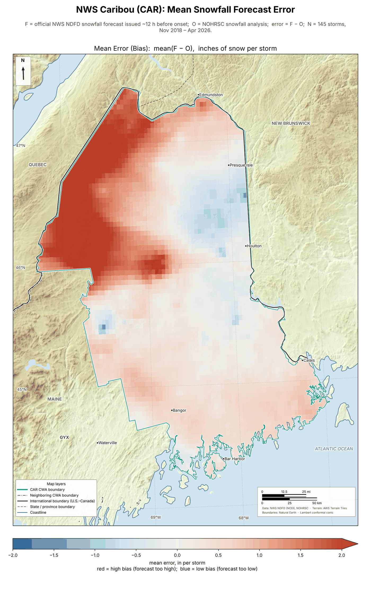</td>
<td align="center"><b>GYX</b><br>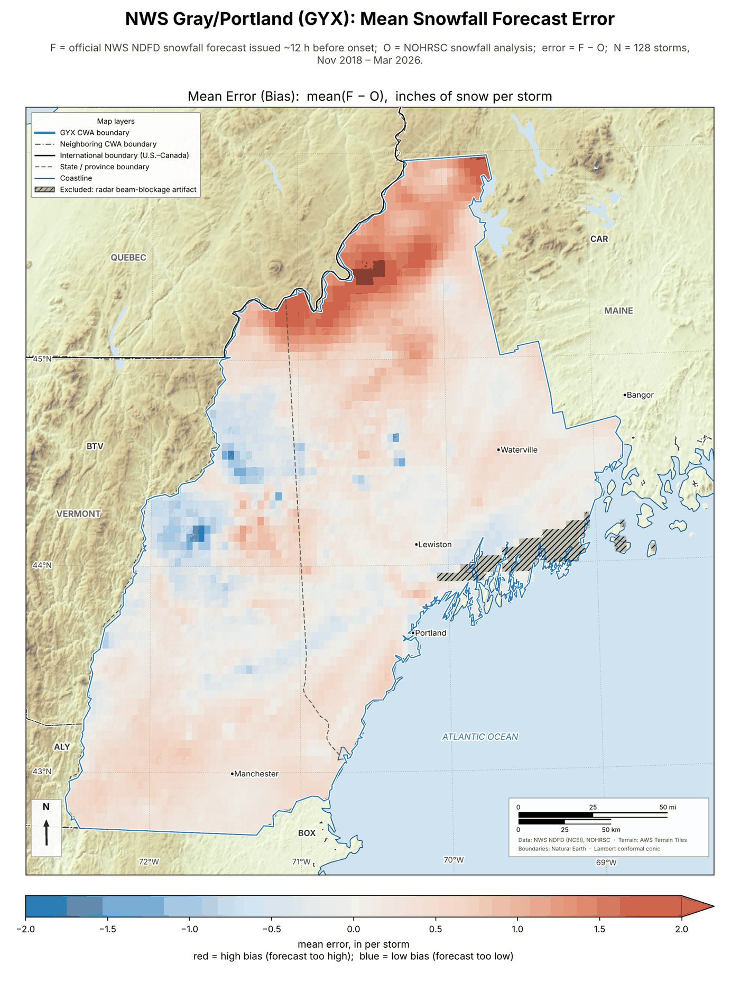</td>
<td align="center"><b>BTV</b><br>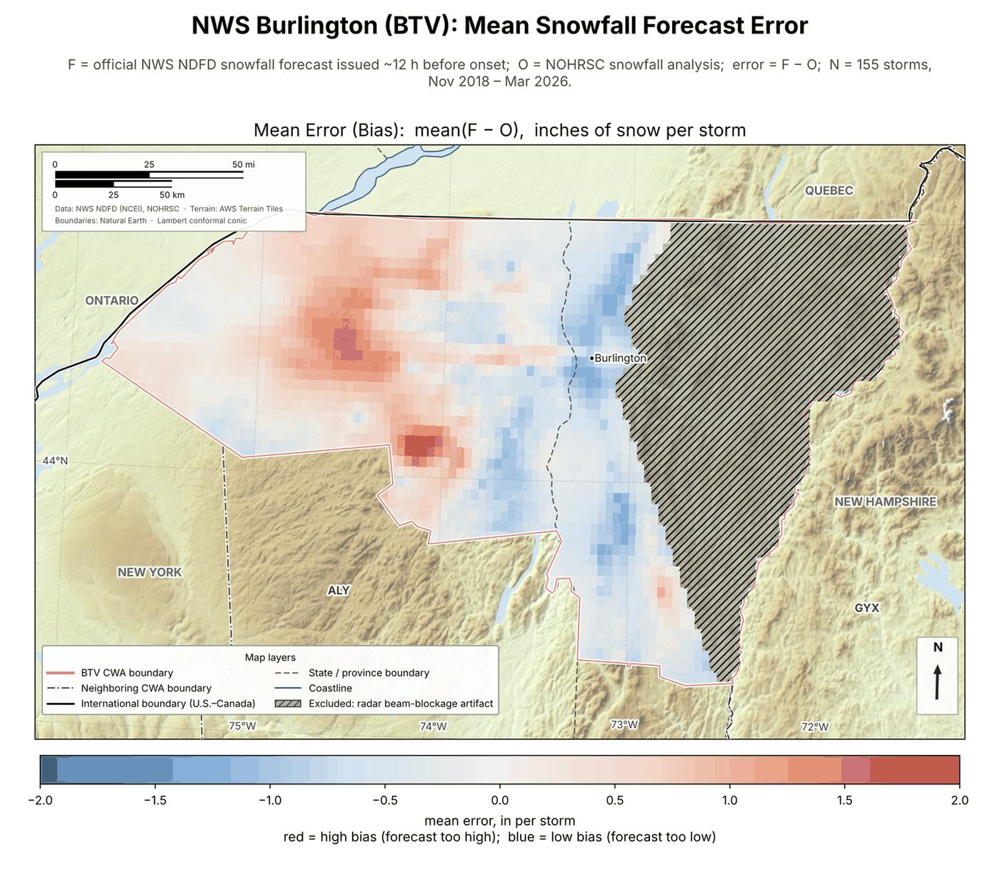</td>
</tr>
<tr>
<td align="center"><b>ALY</b><br>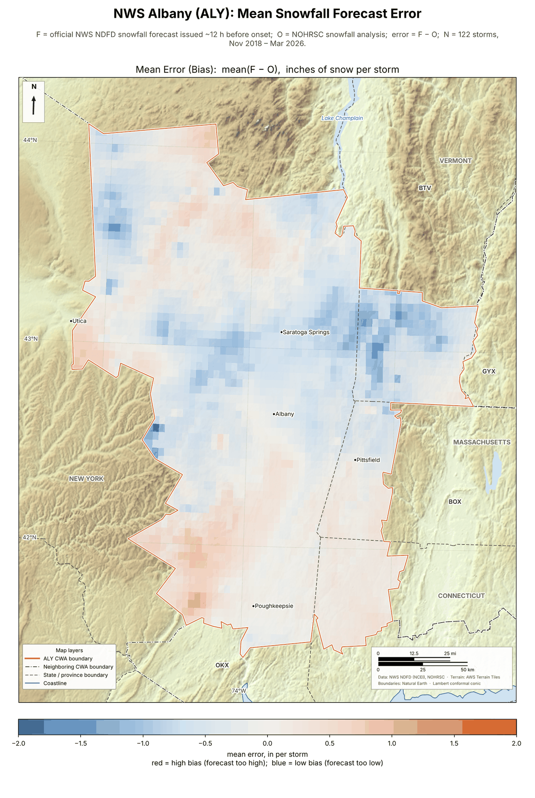</td>
<td align="center"><b>BOX</b><br>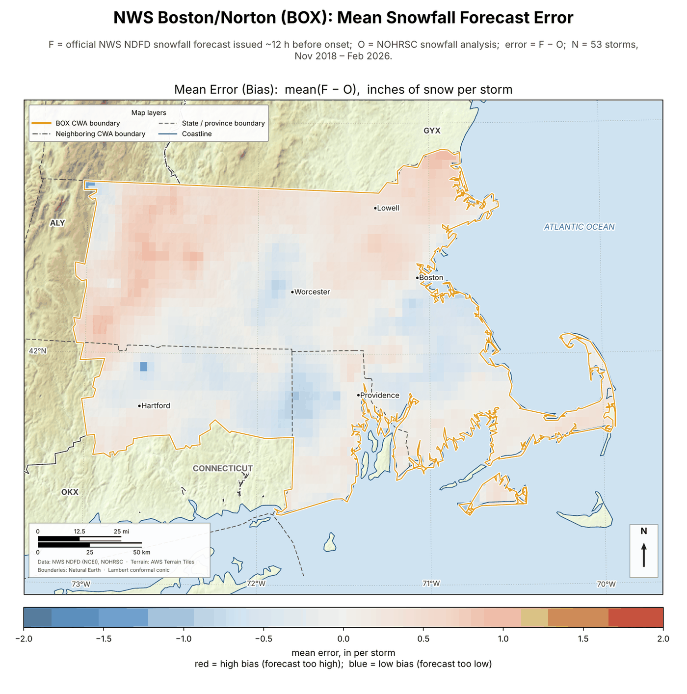</td>
<td align="center"><b>OKX</b><br>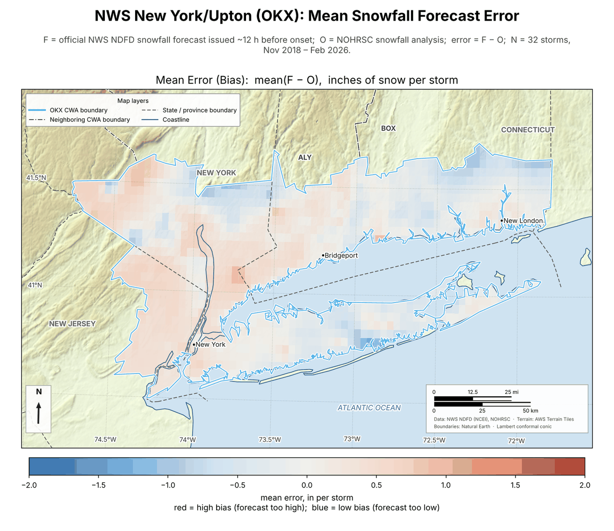</td>
</tr>
</table>

Per-office figure sets (seven figures each) are produced by the pipeline; selected examples are in `docs/figures/`.

### 5.3 More than the mean: error statistics, hit rates and reliability

<p align="center">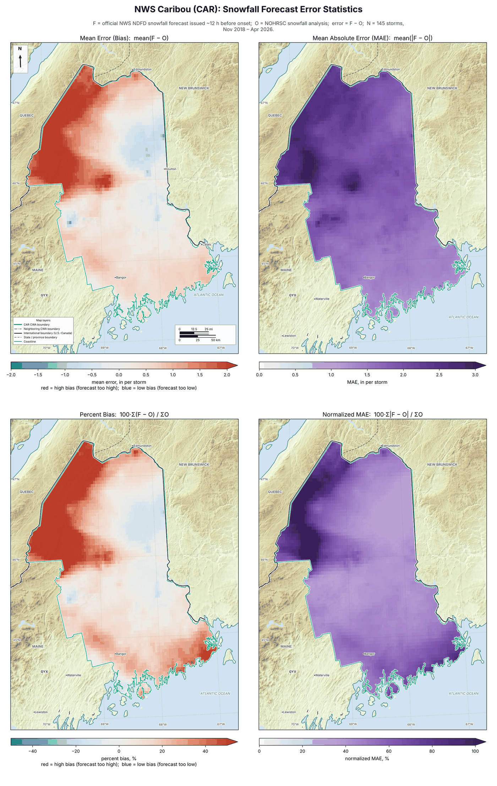</p>

*Caribou: mean error, MAE, percent bias and normalized MAE on the same grid.*

<p align="center">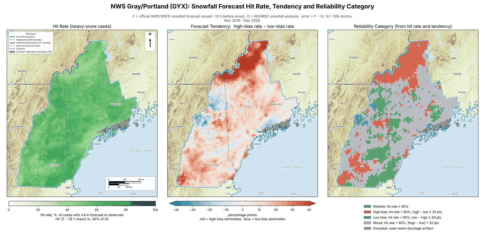</p>

*Gray/Portland: hit rate in heavy-snow cases, forecast tendency (high-bias rate minus low-bias rate) and the resulting reliability category.*

### 5.4 Does bias depend on the amount of snow?

Yes — and how the question is posed matters. Binning all (cell, storm) cases **by forecast amount** (what a user reads) gives one pattern; binning **by observed amount** (what fell) gives the mirror image:

**Given the forecast** (pooled over six offices, full record)

| Forecast amount (in) | Cell-storm cases | Mean F (in) | Mean O (in) | Mean error (in) | Hit | High bias | Low bias |
|---|--:|--:|--:|--:|--:|--:|--:|
| <1 | 360,458 | 0.38 | 0.86 | −0.48 | 91% | 0% | 9% |
| 1-2 | 263,956 | 1.49 | 1.96 | −0.47 | 86% | 0% | 14% |
| 2-4 | 448,051 | 2.95 | 2.98 | −0.03 | 76% | 11% | 13% |
| 4-6 | 278,052 | 4.92 | 4.51 | +0.41 | 61% | 26% | 13% |
| 6-9 | 249,019 | 7.33 | 6.25 | +1.08 | 51% | 41% | 8% |
| 9-12 | 105,713 | 10.26 | 8.76 | +1.50 | 46% | 47% | 7% |
| 12+ | 79,545 | 14.97 | 12.81 | +2.16 | 50% | 45% | 6% |


**Given the observation** (same cases)

| Observed amount (in) | Cell-storm cases | Mean F (in) | Mean O (in) | Mean error (in) | Hit | High bias | Low bias |
|---|--:|--:|--:|--:|--:|--:|--:|
| <1 | 406,592 | 1.06 | 0.35 | +0.71 | 88% | 12% | 0% |
| 1-2 | 263,201 | 2.31 | 1.50 | +0.81 | 81% | 19% | 0% |
| 2-4 | 460,795 | 3.46 | 2.94 | +0.52 | 73% | 20% | 7% |
| 4-6 | 286,032 | 5.18 | 4.91 | +0.27 | 59% | 22% | 19% |
| 6-9 | 210,551 | 7.09 | 7.26 | −0.17 | 54% | 20% | 26% |
| 9-12 | 80,323 | 9.40 | 10.31 | −0.91 | 58% | 13% | 29% |
| 12+ | 77,300 | 12.33 | 16.37 | −4.03 | 57% | 5% | 38% |


**Reading the two tables together.** Any forecast that is imperfectly correlated with the truth will look "too high when it is high" when sorted by forecast, and "too low when the snow was heavy" when sorted by observation. That is *regression to the mean in both directions*, not two separate biases. The by-forecast table is the one a user needs — it is a calibration table — and it says that, on average, **forecast amounts of 6 in or more verified lower than forecast**. But the effect is not purely forecaster behavior: the NDFD grid is a smooth, edited field while the NOHRSC analysis is spatially detailed, and cell-to-cell scale mismatch widens the spread of both tables. The cases are also cells within storms, which are strongly correlated, so counts overstate independent information.

Offices differ at the extreme. For the 12 in or more bins:

| Office | When F ≥ 12 in: mean F → mean O | mean error | When O ≥ 12 in: mean F → mean O | mean error |
|---|--:|--:|--:|--:|
| CAR | 15.2 → 10.8 | +4.45 | 12.6 → 14.7 | −2.14 |
| GYX | 14.7 → 12.1 | +2.56 | 11.8 → 15.7 | −3.91 |
| BTV | 14.2 → 12.4 | +1.79 | 11.0 → 15.6 | −4.54 |
| ALY | 15.2 → 16.0 | −0.84 | 12.5 → 19.0 | −6.45 |
| BOX | 15.3 → 14.3 | +1.06 | 14.1 → 17.2 | −3.15 |
| OKX | 14.5 → 14.1 | +0.36 | 14.0 → 16.0 | −2.01 |


For CAR, forecasts of 12 in or more verified about 4.4 in lower on average; for ALY the same bin is *slightly under-forecast* (−0.8 in), and ALY's under-forecast when 12 in or more fell (−6.4 in) is the largest figure in the table. The biggest single contributor is the 17 Dec 2020 storm (13 % of those cases, mean error −15 in); without it the figure is −5.1 in, still the largest of any office.

<p align="center">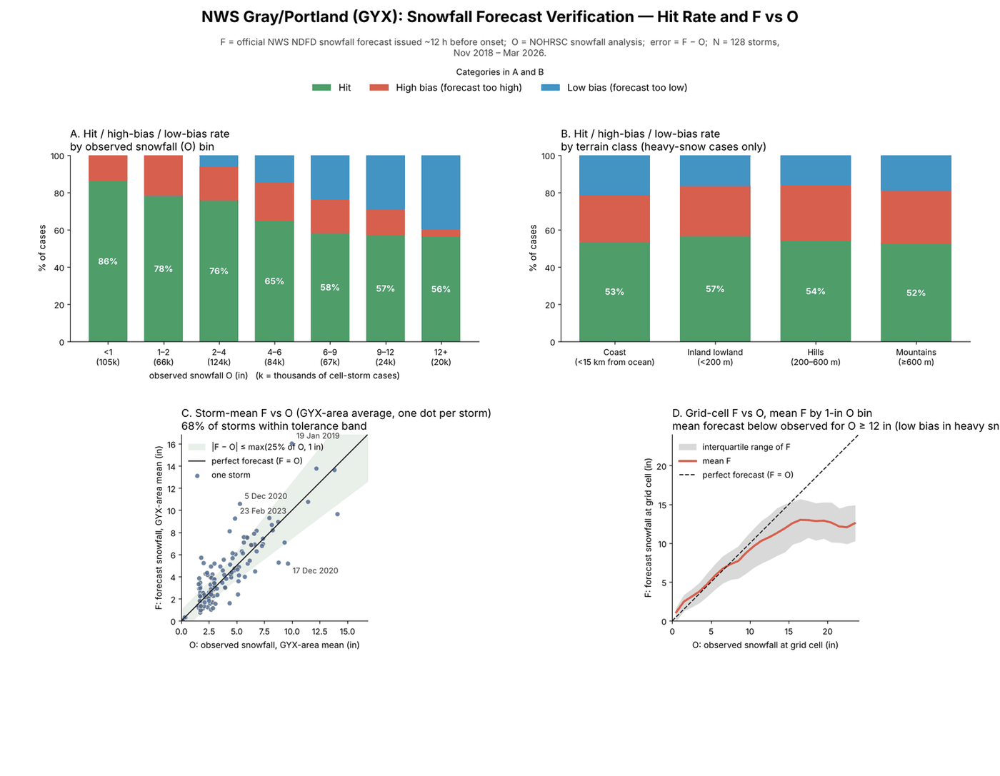</p>

*Gray/Portland: hit / high-bias / low-bias rates by observed amount and terrain class, per-storm F vs O, and mean forecast by observed amount.*

### 5.5 Terrain and coast

| Office | Coast (<15 km) | Inland lowland (<200 m) | Hills (200–600 m) | Mountains (≥600 m) | Split-half r | Variance explained by terrain |
|---|--:|--:|--:|--:|--:|--:|
| CAR | +0.42 (+15%) | +0.18 (+5%) | +0.98 (+24%) | +1.00 (+18%) | 0.94 | 36% |
| GYX | +0.10 (+3%) | +0.18 (+5%) | +0.32 (+8%) | +0.29 (+6%) | 0.82 | 26% |
| BTV | −0.64 (−20%) † | −0.04 (−1%) | +0.10 (+3%) | +0.22 (+5%) | 0.91 | 36% |
| ALY | +0.02 (+1%) | −0.25 (−8%) | −0.20 (−5%) | −0.17 (−3%) | 0.66 | 9% |
| BOX | −0.03 (−1%) | +0.05 (+1%) | +0.12 (+2%) | – | 0.32 | 22% |
| OKX | −0.01 (0%) | +0.08 (+2%) | −0.01 (0%) | – | 0.34 | 5% |

*Cells show mean error in inches per storm (percent bias). † see the known issue below. "Split-half r": median correlation of percent bias between random halves of the storms. "Variance explained": r² between the percent-bias map and its kernel-regression fit on elevation and distance to ocean. Classes with fewer than 15 cells are omitted; CAR's mountains class has only 25 cells.*

* **CAR:** the hills class (200–600 m) is the most biased (+0.98 in, +24 %) versus inland lowlands (+0.18 in, +5 %). Terrain and coast distance explain 36 % of the spatial pattern, and the pattern reproduces between halves (r = 0.94).
* **BTV:** also terrain-structured (36 % explained, r = 0.91) — slightly high on the hills and mountains, slightly low in the lowlands — on the 66 % of the CWA outside the radar exclusion.
* **GYX:** a weak gradient, +0.10 to +0.32 in across classes (largest on the hills), 26 % explained.
* **ALY:** low-biased in the lowland, hills and mountains classes (near zero on the coast); only 9 % explained, so terrain is a poor description of ALY's pattern.
* **BOX and OKX:** nothing reproducible (r ≈ 0.3); the class means are near zero.

> **Known issue — the "coast" class.** Distance to the ocean is computed from terrain-tile pixels at ≤ 0.5 m elevation. That captures the ocean but can also catch other zero-elevation pixels. BTV's 165 "coast" cells lie between 75.5°W and 73.1°W at elevations of 3–650 m — they are in the Adirondack / St. Lawrence area, not on the coast — so the BTV coast row (−0.64 in) should be ignored, and other offices' coast rows should be read with some caution. A cleaner definition (ocean connected to the open Atlantic) is the obvious fix.

<p align="center">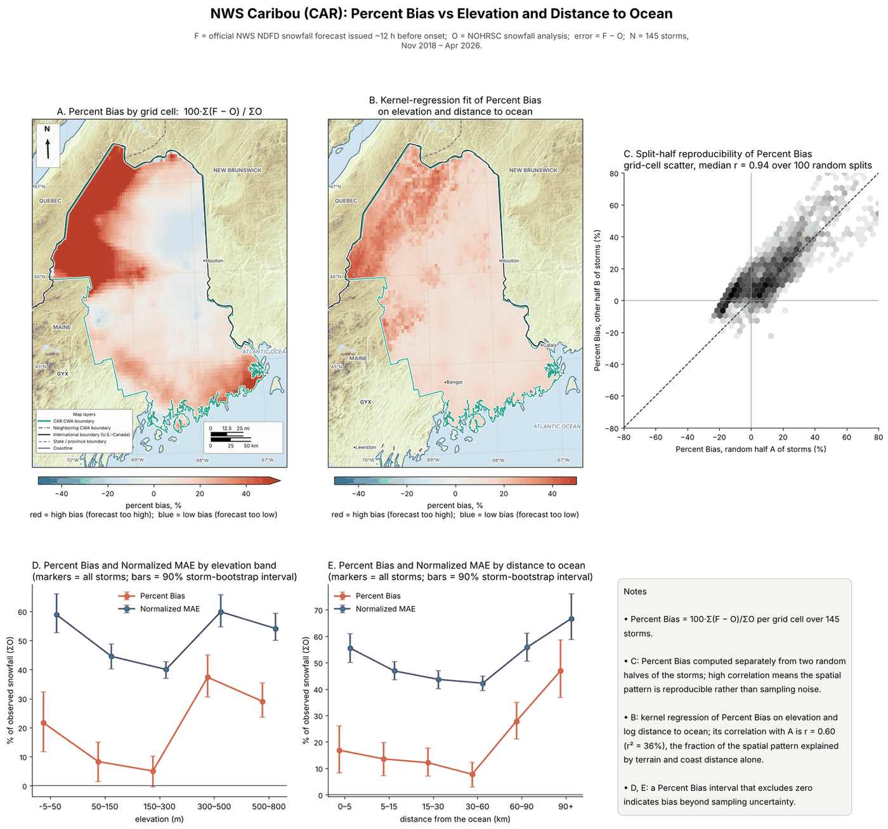</p>

### 5.6 The largest storms

| Office | Storm window start | Observed (in) | Forecast (in) | Error (in) |
|---|---|--:|--:|--:|
| CAR | 20 Jan 2019 | 11.3 | 18.1 | **+6.8** |
| CAR | 6 Feb 2020 | 10.9 | 10.9 | **−0.1** |
| CAR | 23 Mar 2024 | 10.4 | 16.1 | **+5.7** |
| GYX | 23 Mar 2024 | 14.1 | 9.7 | **−4.4** |
| GYX | 25 Jan 2026 | 13.8 | 13.6 | **−0.2** |
| GYX | 3 Apr 2024 | 12.2 | 13.8 | **+1.6** |
| BTV | 16 Dec 2022 | 14.4 | 12.3 | **−2.1** |
| BTV | 15 Feb 2025 | 13.4 | 8.7 | **−4.7** |
| BTV | 6 Feb 2020 | 13.1 | 11.3 | **−1.8** |
| ALY | 17 Dec 2020 | 23.8 | 10.6 | **−13.3** |
| ALY | 25 Jan 2026 | 18.7 | 16.2 | **−2.6** |
| ALY | 13 Mar 2023 | 18.3 | 14.1 | **−4.1** |
| BOX | 25 Jan 2026 | 17.2 | 14.7 | **−2.5** |
| BOX | 23 Feb 2026 | 15.4 | 17.2 | **+1.8** |
| BOX | 1 Dec 2019 | 15.0 | 7.8 | **−7.2** |
| OKX | 22 Feb 2026 | 16.5 | 16.3 | **−0.3** |
| OKX | 25 Jan 2026 | 13.4 | 13.6 | **+0.2** |
| OKX | 29 Jan 2022 | 9.3 | 9.4 | **+0.0** |

*Storm-mean values over the CWA. All five largest storms per office are in `results/largest_storms.csv`.*

* **Misses are storm-specific.** Albany's 17 Dec 2020 storm was observed at 23.8 in and forecast at 10.6 in (−13.3 in), nearly twice the next largest miss in the table (BOX, 1 Dec 2019, −7.2 in). The 1 Dec 2019 storm was under-forecast at both BOX (−7.2 in) and ALY (−4.7 in); New York/Upton's 15–16 Nov 2018 storm verified at 8.3 in against a forecast of 1.9 in.
* **Neighbors can miss in opposite directions.** For the 23–24 March 2024 storm, CAR was 5.7 in too high while GYX was 4.4 in too low — what looks like a systematic bias at one office was, that day, a gradient in the wrong place.
* **Some big storms were forecast very well.** The 25–27 January 2026 storm had storm-mean errors of −0.2 in (GYX), +0.2 in (OKX), −2.5 in (BOX) and −2.6 in (ALY).

<p align="center">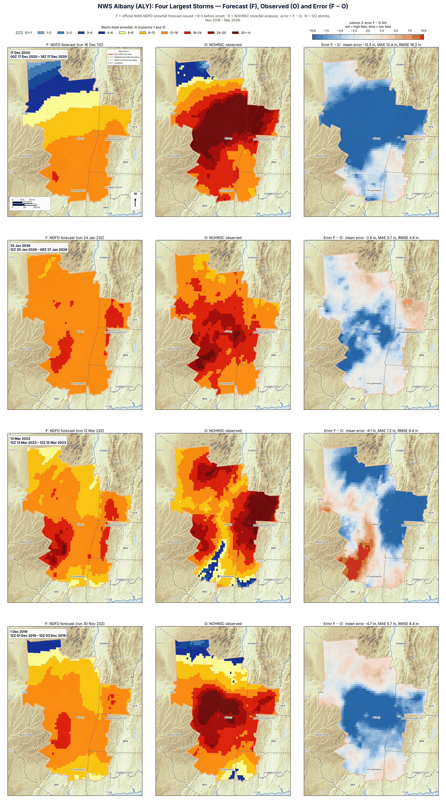</p>

*Albany's four largest storms: forecast, observed and error maps, on one color scale.*

### 5.7 The 2025–26 season

89 storms (July 2025 – June 2026 window). Samples are small, so every interval is wide:

| Office | Storms | Mean F (in) | Mean O (in) | **Mean error (in)** [90% interval] | MAE (in) | RMSE (in) | Percent bias | Norm. MAE | Hit rate | High / low bias |
|---|--:|--:|--:|--:|--:|--:|--:|--:|--:|--:|
| **CAR** Caribou, ME | 17 | 3.59 | 2.96 | **+0.63** [+0.13, +1.15] | 1.69 | 2.35 | +21.1% | 57% | 69% | 23% / 8% |
| **GYX** Gray/Portland, ME | 14 | 4.35 | 4.07 | **+0.28** [−0.34, +0.95] | 1.70 | 2.31 | +6.9% | 42% | 70% | 19% / 11% |
| **BTV** Burlington, VT | 24 | 2.92 | 2.85 | **+0.07** [−0.36, +0.48] | 1.38 | 1.99 | +2.5% | 48% | 76% | 12% / 11% |
| **ALY** Albany, NY | 20 | 2.95 | 3.44 | **−0.50** [−0.90, −0.08] | 1.26 | 1.98 | −14.5% | 37% | 82% | 5% / 13% |
| **BOX** Boston/Norton, MA | 9 | 5.13 | 5.70 | **−0.57** [−1.22, +0.08] | 1.71 | 2.63 | −10.0% | 30% | 81% | 7% / 12% |
| **OKX** New York/Upton, NY | 5 | 7.94 | 8.80 | **−0.86** [−1.71, −0.16] | 2.04 | 2.60 | −9.7% | 23% | 67% | 8% / 25% |


* **CAR's high bias is unchanged** (+0.63 in, vs +0.62 in over the record), and again its interval excludes zero.
* **ALY moved to the low side** (−0.50 in versus −0.18 in; interval −0.90 to −0.08) with a hit rate of 82 %.
* **BOX and OKX are negative** (−0.57 and −0.86 in) but on 9 and 5 storms; only OKX's interval excludes zero and it should be treated as indicative, not conclusive.
* BTV and GYX stayed close to their long-term values.

<p align="center">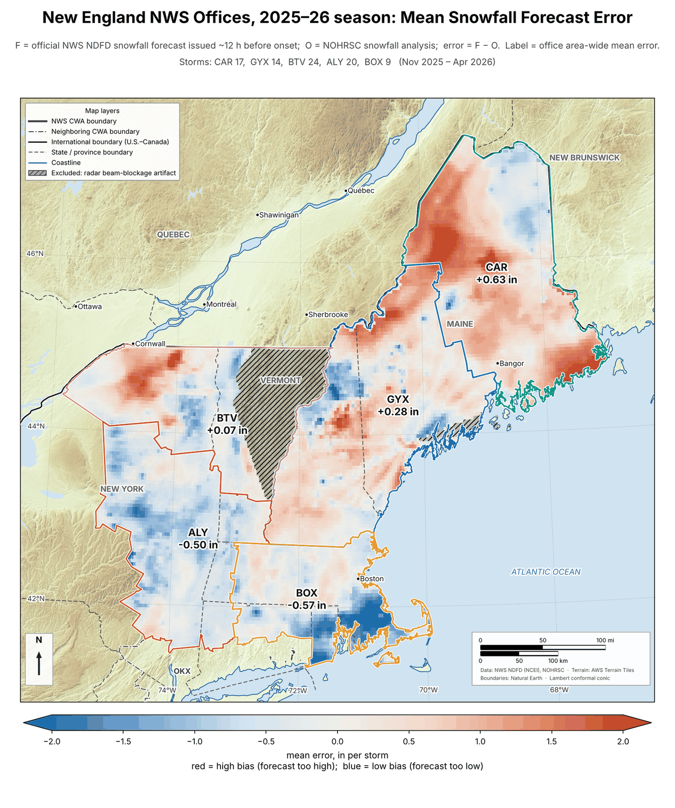</p>

## 6. Discussion

**Magnitude versus direction.** If the question is "how far off is a typical forecast," the six offices are almost interchangeable (≈ 1.7–1.9 in; ≈ 70–74 % hits). If the question is "which way does it lean, and where," they are not. The maps are useful precisely because they separate the two.

**Caribou's northwestern hot spot.** The CAR signal is large, spatially coherent, reproducible across random halves of the storms, and persisted in 2025–26. What this study cannot say is *why*. One candidate is that the observation analysis under-estimates snowfall in a region with sparse reports and radar coverage near the border (the NOHRSC analysis is weakest in sparse-observation terrain); another is a genuine forecast over-estimate; a third is a mixture. Separating them requires an independent observation source (section 7).

**Heavy snow.** The most operationally important finding is the calibration of large forecasts: on average, forecasts of 6 in or more verified lower than forecast. Because that is partly an unavoidable statistical consequence of an imperfect forecast, the useful comparison for a forecaster is against a reference (for example the unedited guidance), not against zero. This study does not make that comparison.

**Regional storm structure.** Several of the largest misses were shared across offices, and the March 2024 storm produced opposite-sign errors at adjacent offices. Verification at the single-office level hides that these may be errors in the placement of the storm's gradient rather than office-specific habits.

**Using the maps.** Percent-bias and mean-error maps are most useful where the split-half correlation is high (CAR, BTV, GYX). Where it is low (BOX, OKX), the maps mostly show sampling noise and the area-wide mean is the more honest summary.

## 7. Limitations and threats to validity

* **The "truth" is an analysis.** NOHRSC is a model-and-observation blend, not a gauge network. Its errors are not independent of the weather, and it is weakest where reports are sparse. Part of what is called forecast bias here could be analysis bias. An independent check against station reports (COOP, CoCoRaHS, ASOS) is the most important missing piece.
* **No reference forecast.** The study measures the issued forecast against the analysis; it does not say whether forecasters add value over guidance, because no guidance forecast is evaluated.
* **One lead time.** Forecasts are issued ≥ 12 h before onset (9 of 635 at ≥ 6 h). Bias at other leads is not studied.
* **Storm selection.** Only events with a CWA-mean total of ≥ 1.5 in are included, and storms are defined from the observations. Light events and their forecast behavior are out of scope.
* **Dependence in the sample.** Cells within a storm, and offices within a storm, are strongly correlated. Case counts are not independent samples, and the bootstrap treats storms as exchangeable across the record.
* **Small samples.** BOX (53) and OKX (32) have few storms; every 2025–26 office has 24 or fewer.
* **Radar exclusion.** One third of BTV's CWA is excluded, and the exclusion removes cells *because* the analysis is unreliable there, so no claim is made about the forecast in those cells.
* **Process changes.** Forecast production changed over eight years (guidance, tools, staffing). The study reports period averages and does not separate these effects.
* **Grid mismatch.** The NDFD grid (edited, smoothed) and the NOHRSC analysis (detailed) differ in scale; part of the cell-level error is representativeness, not forecast skill.
* **Terrain classes.** The coast class is imprecisely defined (section 5.5).
* **Time conventions.** Period timestamps are UTC period-end times. A storm's "date" in tables is the start of its window.

## 8. Reproducing the study

### Install

```bash
git clone <this repository>
cd ne-wfo-snowfall-verification
pip install -r requirements.txt     # pygrib needs the ECCODES library: apt install libeccodes-dev  (or conda install -c conda-forge pygrib)
```

### Run

```bash
# everything, all six offices (downloads, storm detection, verification, all figures)
python nws_snowfall_verification.py --workdir ./work

# a quick test: one winter, two offices (≈ 3–5 min; ~330 MB from NOHRSC, ~190 MB from NCEI)
python nws_snowfall_verification.py --workdir ./work --start 2022-11-01 --end 2023-04-30 --offices GYX BTV

# redraw figures only / one season only
python nws_snowfall_verification.py --workdir ./work --stages figures --force
python nws_snowfall_verification.py --workdir ./work --stages figures --season 2025-26

# the tables in this README
python scripts/summary_statistics.py --workdir ./work

# check another radar site for beam-blockage artifacts
python nws_snowfall_verification.py radar-test GYX -70.257 43.891
```

Every stage is **resume-safe**: re-running skips downloads and figures that already exist (`--force` redoes them). The script has four stages:

| Stage | What it does | Output (under `work/`) |
|---|---|---|
| `terrain` | AWS Terrarium tiles → elevation grid | `terrain/dem.npz` |
| `cube` | NOHRSC 6-hour snowfall, New England window | `nohrsc_cube/*.npy` |
| `storms` | storm detection, NDFD fetch and regrid, per office | `storms/ndfd_<OFFICE>.pkl` |
| `figures` | maps and charts for each office, plus the regional map | `figures/` |

Figures per office: `_0_mean_error_map`, `_1_bias_MAE_maps`, `_2_hit_rate_maps`, `_3_error_charts`, `_4_bias_terrain_coast`, `_5_largest_storms_F_O_error`, `_6_mean_F_O_error_maps`, plus `regional_mean_error_map`.

### Efficiency and server politeness

* All downloads go through one HTTP layer with **keep-alive connections, per-host connection and requests-per-second caps** (NOHRSC 6 connections / 8 req/s; NCEI 4 / 3), exponential backoff with jitter, `Retry-After` support, automatic slow-down on 429/503 and a descriptive User-Agent. None of the hosts publishes a numeric limit, so the defaults are deliberately modest; override with `--nohrsc-rate` and `--ncei-rate`.
* **NOHRSC:** the file layout (compressed or uncompressed) is probed once per month. Compressed files are fetched whole; older uncompressed files are fetched with **multi-range requests for only the New England rows and columns** (~0.3 MB instead of 5.1 MB).
* **NDFD:** a day's THREDDS catalog (3.8 MB) is read only for the days that are needed; only the 12-hour-lead run is downloaded up front and the 6-hour fallback only for storms it cannot cover; each run file is downloaded once and shared by every office.
* **Processing:** the 2.5 km → 0.04° regrid is a sparse-matrix multiply with weights built once; decoding runs in parallel processes; figure drawing uses a base map projected once and cached, image warps are cached index lookups, and offices draw in parallel (`--jobs`).
* Measured on a 2-CPU machine, one winter and two offices from an empty directory: 729 requests / 320 MB to NOHRSC and 50 requests / 189 MB to NCEI, with no throttling responses, in 3–5 min (the NOHRSC stage is paced by the request cap). The full eight-year record needs several GB of downloads and about 8 GB of working space; it was not re-timed end to end from an empty directory.
* Outputs of the verification steps were regression-tested after every optimization: forecast fields match the unoptimized version to within 4 × 10⁻⁶ in; the downloaded observation cube is byte-identical.

### Configuration

Offices, thresholds, radar exclusions and network limits are in the **SETTINGS** block at the top of `nws_snowfall_verification.py`. To add an office, add it to `OFFICES` and `ORDER`; its CWA polygon is fetched automatically from the NWS reference map service if it is missing from `data/cwa_new_england.geojson`.

## 9. Repository layout

```
nws_snowfall_verification.py   the whole pipeline in one file: download, storm detection, verification, maps, regional map, radar test
scripts/summary_statistics.py  recomputes every table in this README from the pipeline's storm files
data/cwa_new_england.geojson   NWS county warning area polygons used for the results here
results/                       CSV tables behind the README (office summary, by-amount, by-terrain, largest storms)
docs/figures/                  selected figures used in this README (downsized)
requirements.txt
```

## 10. Data sources and credits

* **NDFD forecasts:** NOAA NCEI, *National Digital Forecast Database* THREDDS archive — <https://www.ncei.noaa.gov/thredds/catalog/model-ndfd-file_kwbn/> (and `…-old` for 2018 – May 2020).
* **Snowfall analysis:** NOAA NWS National Operational Hydrologic Remote Sensing Center (NOHRSC), *National Snowfall Analysis* — <https://www.nohrsc.noaa.gov/snowfall_v2/>.
* **Terrain:** *Terrain Tiles* on the AWS Open Data registry — <https://registry.opendata.aws/terrain-tiles/>.
* **County warning areas:** NWS Reference Map Web Service — <https://mapservices.weather.noaa.gov/static/rest/services/nws_reference_maps/nws_reference_map/MapServer>.
* **Base map:** Natural Earth 10 m physical and cultural layers — <https://www.naturalearthdata.com/>.
* **Software:** NumPy, SciPy, Matplotlib, Cartopy, Shapely, pyproj, pygrib, tifffile, Pillow, requests.

Downloads are from public NOAA and open-data services. Please keep the request-rate caps in place when running the pipeline.

## License

*To be added by the repository owner.*
